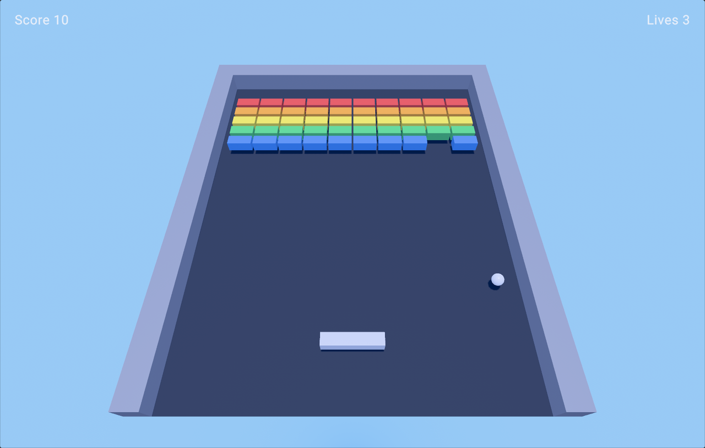

# Breakout

A small 3D Breakout: a paddle, a ball and a wall of fifty bricks in five colors on
a walled table. Clear the wall before you run out of lives.

## Play

1. Open the project in the editor and open `Assets/Scenes/Breakout.scene`.
2. Press Play, then click the Game View so it has keyboard focus.

| Key | Action |
| --- | --- |
| A / D or Left / Right | Move the paddle |
| Space | Launch the ball (it also launches by itself after a moment) |
| R | Restart after a win or a game over |

Bricks score 10 (blue) to 50 (red) points. You have three lives.

## How it is made

- **Scene**: engine primitives (cubes, a sphere, a plane) with plain colored
  materials under `Assets/Materials/`, a fixed camera, the default sky and light.
- **Physics**: every piece is a Jolt body. The ball is a dynamic sphere with no
  gravity, no friction and full restitution; the walls and bricks are static boxes;
  the paddle is a kinematic box.
- **Gameplay**: one C++ system, `Assets/Scripts/BreakoutSystem.cpp`. It moves the
  paddle from the keyboard, listens to the ball's contacts
  (`PhysicsEntityEventCallbacks`), switches a hit brick's entity off and adds its
  points, keeps the ball at a steady speed on the table, and aims a paddle return by
  where the ball struck the paddle. Bricks are marked with a small component,
  `BreakoutBrick` (`Assets/Scripts/BreakoutBrick.h`), whose `Points` you can edit per
  brick in the Inspector.
- **HUD**: `Assets/UI/Hud.uxml` and `Hud.css`, mounted by a UIDocument; the system
  writes the score, lives and prompt labels.

The editor compiles the C++ under `Assets/` into the project's script module when the
project opens and again whenever a script file is saved, and swaps the new module in
without a restart. On Windows this needs the toolchain the engine itself needs: Visual
Studio 2026 with the "Desktop development with C++" workload.
