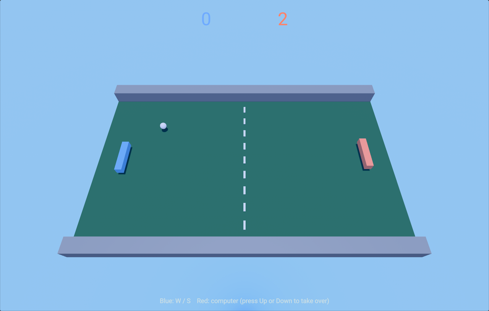

# Pong

Two paddles, one ball, first to five. Play the computer, or hand the red paddle to
a second player.

## Play

1. Open the project in the editor and open `Assets/Scenes/Pong.scene`.
2. Press Play, then click the Game View so it has keyboard focus.

| Key | Action |
| --- | --- |
| W / S | Move the blue (left) paddle |
| Up / Down | Take over the red (right) paddle from the computer and move it |
| R | Start a new match after a win |

The ball speeds up a little with every return. The match rules (points to win, ball
speeds, the computer's speed) are on the `Rules` entity's `PongRules` component;
edit them in the Inspector.

## How it is made

- **Scene**: engine primitives with plain colored materials, a fixed camera, the
  default sky and light.
- **Physics**: the ball is a Jolt sphere with no gravity, no friction and full
  restitution; the side walls are static boxes, the paddles kinematic boxes. Each
  goal is a trigger box behind a paddle.
- **Gameplay**: one C++ system, `Assets/Scripts/PongSystem.cpp`. It moves the paddles
  from the keyboard (or the computer's simple tracking), listens to the ball's paddle
  contacts and goal triggers (`PhysicsEntityEventCallbacks`), aims a return by where
  the ball struck the paddle, keeps score and serves.
- **HUD**: `Assets/UI/Hud.uxml` and `Hud.css`, mounted by a UIDocument.

The editor compiles the C++ under `Assets/` into the project's script module when the
project opens and again whenever a script file is saved, and swaps the new module in
without a restart. On Windows this needs the toolchain the engine itself needs: Visual
Studio 2026 with the "Desktop development with C++" workload.
