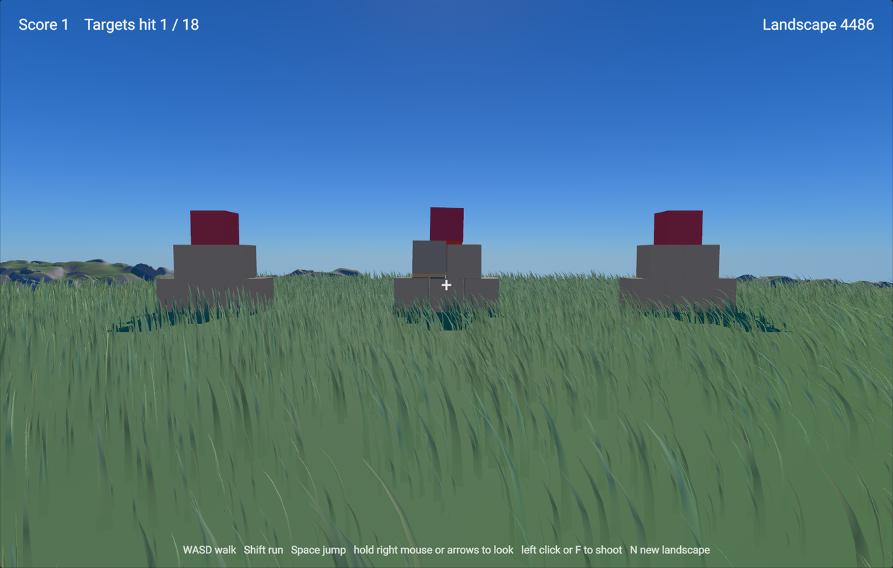

# Terrain FPS

Walk a randomly generated landscape in first person and knock over stacks of crates
with a hitscan gun or a stream of bouncing balls. Every press of Play grows a new
landscape.

## Play

1. Open the project in the editor and open `Assets/Scenes/TerrainFPS.scene`.
2. Press Play, then click the Game View so it has keyboard focus.

| Input | Action |
| --- | --- |
| W A S D | Walk |
| Shift | Run |
| Space | Jump |
| Right mouse button held, or the arrow keys | Look around |
| Left mouse button held | Fire balls |
| F | Shoot (hitscan) |
| N | Grow a new landscape |

Crates score 1 point and the red boxes on top score 3, on the first hitscan hit each.

## How it is made

- **Terrain**: the engine's terrain system. A 512 m terrain with the built-in
  materials, height-based surface rules, grass, a world-wide noise effect ("Hills")
  and a flatten effect that keeps a clearing around the start. The game picks a new
  noise seed on every play and on N, and the terrain rebuilds from it.
- **Player**: a `CharacterController` capsule; the system sets its walking velocity and
  jump each frame and the physics moves it over the terrain. The camera is its own
  entity placed at the player's eye every frame (not a child of the player: a child of
  a `CharacterController` entity does not follow it in play mode, a known engine
  issue, #3623).
- **Gun**: a physics ray cast from the eye (`PhysicsWorld::RayCast`); a hit on a
  dynamic body gets an impulse at the hit point, and a hit on an `FpsTarget`
  (`Assets/Scripts/FpsTarget.h`) scores its `Points`.
- **Balls**: `Assets/Scripts/ProjectileLauncherSystem.cpp` spawns a small sphere entity
  at the eye with a dynamic Jolt body whose initial velocity points along the view,
  four a second while the button is held. The balls fall, bounce and roll on the
  terrain and push the crates; a `Projectile` component (`Assets/Scripts/Projectile.h`)
  counts down their six seconds.
- **Gameplay**: the walking, the look and the hitscan gun are one C++ system,
  `Assets/Scripts/FirstPersonSystem.cpp`.
- **HUD**: `Assets/UI/Hud.uxml` and `Hud.css`, mounted by a UIDocument.

The pointer is not captured during play, so the look follows a right-button drag.

The editor compiles the C++ under `Assets/` into the project's script module when the
project opens and again whenever a script file is saved, and swaps the new module in
without a restart. On Windows this needs the toolchain the engine itself needs: Visual
Studio 2026 with the "Desktop development with C++" workload.
